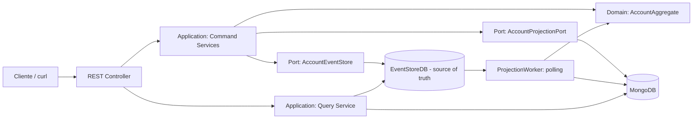

# Event Sourcing + CQRS + Arquitetura Hexagonal — Java 25

Laboratório de engenharia de software com **Java 25**, **Spring Boot 3.5.7**, **EventStoreDB**, **MongoDB**, **JUnit 5**, **CQRS**, **replay** e **consistência eventual**. Inspirado em um exemplo de conta bancária com histórico imutável.

> **Objetivo:** compreender *por que* e *como* persistir eventos em vez de sobrescrever apenas o estado atual. É um **laboratório educacional**, não uma implementação bancária pronta para produção.

## 1. Arquitetura



**Escrita:** HTTP → caso de uso → regras de domínio → `appendToStream` com `expectedRevision` → evento persistido. **Leitura:** `GET /accounts/{id}` consulta o MongoDB (projeção potencialmente atrasada). **Leitura forte:** `GET /accounts/{id}/state` reconstitui o agregado diretamente do stream. **Replay:** reconstrói a projeção a partir dos eventos, sem reescrever o histórico.

A arquitetura é **hexagonal** porque o domínio não importa Spring, EventStoreDB nem MongoDB. As interfaces (`ports`) são contratos da aplicação, implementados por adaptadores externos.

```text
src/main/java/dev/lab/eventsourcing/
├── domain/
│   ├── AccountAggregate.java           # invariantes e reconstrução
│   ├── AccountEvent.java               # eventos de domínio (records + sealed)
│   └── StoredEvent.java                # Event ID, revision, timestamp
├── application/
│   ├── port/AccountEventStore.java      # porta de persistência de eventos
│   ├── port/AccountProjectionPort.java  # porta de leitura
│   └── service/                        # comandos, consultas, transferências, replay
├── adapter/
│   ├── in/web/                          # REST API e tratamento de erros
│   └── out/
│       ├── eventstore/                 # EventStoreDB Java gRPC SDK
│       └── mongo/                      # documentos e repositories
└── config/                              # beans e worker de projeção
```

### Eventos e stream

Stream por agregado: `account-<UUID>`. Tipos de evento versionados:

| Event Type | Efeito no agregado |
|---|---|
| `account.opened.v1` | Abre conta com saldo R$ 0,00 |
| `account.deposited.v1` | Adiciona saldo |
| `account.withdrawn.v1` | Subtrai saldo (não permite negativo) |
| `account.transfer-debited.v1` | Debita transferência na origem |
| `account.transfer-credited.v1` | Credita transferência no destino |

Cada evento possui `eventId`, `occurredAtEpochMs`, `accountId` e campos de negócio. A **revision** é a posição do evento no stream, iniciando em `0`; não é o `eventId`. `expectedRevision` fornece **concorrência otimista**: uma escrita baseada em versão desatualizada falha com `409`.

## 2. Pré-requisitos

- **JDK 25** (`java -version`) e **Maven 3.9+** (`mvn -version`). Se usar SDKMAN: `sdk list java` e `sdk install java <identificador-do-JDK-25>`; confirme com `sdk current java`.
- **Podman** com provedor Compose (`podman compose`) **ou Docker Compose**.
- `curl`, `jq`, `python3` para os scripts de laboratório.
- Portas locais `8080`, `2113` e `27017` disponíveis.

> **Linux Mint + Podman:** se `podman compose` informar que não há provedor, instale/configure `podman-compose` e use `podman-compose up -d`. Os serviços ficam publicados apenas em `127.0.0.1`. Caso o sistema já tenha MongoDB na porta 27017, pare o serviço ou ajuste a porta no `compose.yaml` e a URI.

## 3. Subir o laboratório

Na raiz do projeto:

```bash
podman compose up -d
podman compose ps
# alternativa: docker compose up -d
```

Aguarde o EventStoreDB iniciar. Console local: <http://localhost:2113>. O MongoDB estará em `mongodb://localhost:27017/event_sourcing_lab`.

```bash
java -version  # deve indicar 25
mvn -version
mvn clean test
mvn spring-boot:run
```

Em outro terminal:

```bash
curl -fsS http://localhost:8080/actuator/health
```

**Importante:** o servidor de EventStoreDB está com TLS/autenticação desativados **apenas para uso local**. Nunca exponha as portas ou utilize esta configuração em produção.

## 4. Laboratório guiado — CRUD vs Event Sourcing

### 4.1. Abrir duas contas

```bash
export A=$(python3 -c 'import uuid; print(uuid.uuid4())')
export B=$(python3 -c 'import uuid; print(uuid.uuid4())')
export T=$(python3 -c 'import uuid; print(uuid.uuid4())')

curl -i -X POST http://localhost:8080/api/accounts \
  -H 'Content-Type: application/json' \
  -d "{\"accountId\":\"$A\",\"owner\":\"Ana\"}"

curl -i -X POST http://localhost:8080/api/accounts \
  -H 'Content-Type: application/json' \
  -d "{\"accountId\":\"$B\",\"owner\":\"Bruno\"}"
```

**Esperado:** HTTP `201`, stream `account-<UUID>` criado. O `GET` do Mongo pode retornar `404` por alguns instantes até o worker projetar.

### 4.2. Depositar e sacar

```bash
curl -i -X POST "http://localhost:8080/api/accounts/$A/deposits" \
  -H 'Content-Type: application/json' \
  -d '{"amount":10000.00,"reference":"SALARIO"}'

curl -i -X POST "http://localhost:8080/api/accounts/$A/withdrawals" \
  -H 'Content-Type: application/json' \
  -d '{"amount":1500.00,"reference":"ATM"}'

curl -s "http://localhost:8080/api/accounts/$A/events" | jq .
curl -s "http://localhost:8080/api/accounts/$A/state" | jq .
curl -s "http://localhost:8080/api/accounts/$A" | jq .
```

**Esperado:** saldo `8500.00`; histórico com `Opened`, `Deposited`, `Withdrawn`, revisões `0`, `1`, `2`. A consulta `/state` é reconstruída do EventStoreDB; `/accounts/{id}` lê a projeção Mongo.

### 4.3. Consistência eventual

1. Abra dois terminais. No primeiro, execute um depósito.
2. No segundo, compare imediatamente `/state` (EventStoreDB) com `/accounts/{id}` (MongoDB).
3. Aguarde ~2 segundos e compare novamente.
4. Para tornar o atraso visível, execute a aplicação com `PROJECTION_INTERVAL_MS=10000 mvn spring-boot:run` (reinicie a aplicação).

**Pergunta:** qual endpoint é mais adequado para um extrato analítico? E para validar saldo disponível antes de um saque? **Resposta:** a decisão de comando deve usar o agregado reconstituído do stream; a projeção pode estar atrasada.

### 4.4. Transferência entre streams e falha parcial

A transferência usa **dois streams distintos**, portanto **não há transação atômica** entre débito e crédito. O laboratório usa `transferId` como chave de idempotência de negócio para permitir reenvio seguro.

```bash
# Após abrir as duas contas e depositar na origem:
export BODY="{\"transferId\":\"$T\",\"from\":\"$A\",\"to\":\"$B\",\"amount\":200.00}"

# Falha injetada DEPOIS do débito (HTTP 503). O débito já está gravado.
curl -i -X POST http://localhost:8080/api/transfers \
  -H 'Content-Type: application/json' \
  -H 'X-Lab-Fail-After-Debit: true' -d "$BODY"

# Reenvio do MESMO transferId: conclui o crédito sem duplicar o débito.
curl -i -X POST http://localhost:8080/api/transfers \
  -H 'Content-Type: application/json' -d "$BODY"

# Repetir novamente é idempotente para esse transferId:
curl -i -X POST http://localhost:8080/api/transfers \
  -H 'Content-Type: application/json' -d "$BODY"

curl -s "http://localhost:8080/api/accounts/$A/state" | jq .
curl -s "http://localhost:8080/api/accounts/$B/state" | jq .
```

**Discussão:** após a falha simulada, o débito existe e o crédito ainda não. Em produção, seria necessário um **process manager/saga durável**, retries com backoff, detecção de transferências pendentes, compensação/reconciliação e observabilidade. **Este exemplo só recupera a transferência quando o mesmo comando é reenviado**. Não há garantias bancárias de liquidação.

### 4.5. Event Replay — reconstruir MongoDB

```bash
# Apagar SOMENTE a projeção de leitura, preservando o stream no EventStoreDB:
podman compose exec mongodb mongosh --quiet event_sourcing_lab --eval \
  "db.account_projections.deleteOne({_id:'$A'})"

# Reconstruir a projeção a partir do stream imutável:
curl -sS -X POST "http://localhost:8080/api/accounts/$A/replay" | jq .
curl -sS "http://localhost:8080/api/accounts/$A/events" | jq 'length'
```

**Esperado:** o saldo reaparece sem perda do histórico. O replay é determinístico porque recalcula o estado a partir dos eventos, não dispara novos depósitos ou saques.

> Atenção: o worker também pode reconstruir a projeção automaticamente no próximo ciclo. O endpoint `/replay` permite fazer isso sob demanda.

### 4.6. Conflito de concorrência

Duas retiradas de R$ 80,00 sobre um saldo de R$ 100,00 não podem ser aceitas simultaneamente:

```bash
./scripts/lab-concurrency.sh
```

**Esperado:** uma chamada `202` e outra `409` (revisão desatualizada) ou `422` (saldo insuficiente); saldo final R$ 20,00. O controle é feito com `expectedRevision`, não com o saldo eventual do Mongo.

### 4.7. Smoke test automatizado

```bash
./scripts/lab-smoke.sh
# Sob outra porta: API_URL=http://localhost:9090 ./scripts/lab-smoke.sh
```

O script abre contas, deposita, saca, injeta falha após débito, reenvia a transferência, verifica saldos e executa replay. Retorna código de saída não zero se uma asserção falhar.

## 5. Testes unitários

```bash
mvn clean test
mvn -q -Dtest=AccountAggregateTest test
mvn -q -Dtest=TransferServiceTest test
mvn -q -Dtest=ProjectionServiceTest test
mvn -q -Dtest=AccountEventCodecTest test
mvn package
```

| Teste | Cenário validado |
|---|---|
| `AccountAggregateTest` | Rehidratação, saldo, precisão monetária, saque sem fundos, revision |
| `AccountCommandServiceTest` | Append sequencial e abertura duplicada |
| `AccountCommandMockitoTest` | Verificação de interações com as portas usando Mockito |
| `TransferServiceTest` | Retry após falha parcial, idempotência, saldo insuficiente |
| `ProjectionServiceTest` | Consistência eventual, reconstrução e integridade do stream |
| `AccountEventCodecTest` | Serialização/deserialização dos cinco tipos de eventos |

Testes unitários usam **fakes em memória** das portas, sem EventStoreDB nem MongoDB. O smoke test e o teste de concorrência são **testes de integração manuais**, exigindo serviços e API em execução. JUnit 5 e Mockito são disponibilizados pelo `spring-boot-starter-test`.

## 6. Inspeção dos dados

```bash
# Ver coleções MongoDB
podman compose exec mongodb mongosh --quiet event_sourcing_lab --eval \
  'db.account_projections.find().pretty()'

# Contar streams no banco de leitura (são índices, NÃO o event store)
podman compose exec mongodb mongosh --quiet event_sourcing_lab --eval \
  'db.tracked_accounts.countDocuments({})'

# Ver eventos de uma conta, em ordem de revision
curl -s "http://localhost:8080/api/accounts/$A/events" | jq .
```

No EventStoreDB, os streams são visíveis no painel HTTP da porta 2113. **Stream ID** identifica a conta; **Event ID** identifica cada fato; **Revision** representa a versão do stream.

## 7. Desafios de arquitetura — próximos laboratórios

1. **Snapshots:** salvar um snapshot a cada 100 eventos e comparar tempo de reidratação.
2. **Projeção incremental:** substituir polling de streams por `subscribeToAll` ou assinatura persistente, com checkpoint durável e deduplicação.
3. **Saga de transferência:** persistir o estado da saga e implementar recuperação automática, retries e reconciliação.
4. **Resiliência:** desligar o MongoDB após o append, restaurá-lo e medir o tempo até convergir.
5. **Segurança:** habilitar TLS, credenciais, autenticação/autorização HTTP e mascaramento de dados sensíveis.
6. **Observabilidade:** adicionar OpenTelemetry, métricas de lag da projeção, logs com correlation ID e tracing.
7. **Testcontainers:** subir EventStoreDB e MongoDB em testes de integração isolados, com pipelines CI.
8. **Evolução de eventos:** criar `account.deposited.v2` e um upcaster, mantendo compatibilidade com eventos antigos.

## 8. Limitações intencionais e decisões de design

- **EventStoreDB é a fonte de verdade**; MongoDB é um read model descartável/reconstruível.
- **Polling didático:** o worker consulta streams das contas rastreadas no MongoDB a cada 2s. Reprocessa o histórico inteiro e compara a última revision. É simples e idempotente, mas **não escala** para alto volume; a descoberta de contas depende do índice MongoDB.
- **Replay por conta:** reconstitui apenas uma projeção. Para replay global, percorrer streams de maneira confiável ou consumir `$all` com checkpoint.
- **Transferência entre duas contas:** não é atomicamente confirmada. Retry exige mesmo `transferId`, mesmos IDs e valor. **Não usar para movimentação financeira real**.
- **Sem controle de acesso**, sem TLS e com o modo de falha de laboratório habilitado por padrão. Configure `LAB_ENABLED=false` fora de testes locais; isso **não torna** a aplicação pronta para produção.
- **Sem snapshot, retenção, DLQ, checkpoint durável ou versionamento de contrato além de v1.** Esses são exercícios propostos.
- **Valores monetários:** `BigDecimal`, duas casas decimais, sem `double` para dinheiro.
- **Sem exclusão de eventos:** auditoria exige retenção e governança adequadas, inclusive considerações de privacidade e LGPD.

## 9. Parar e limpar

```bash
podman compose down
# APAGA todos os dados do laboratório (cuidado):
podman compose down -v
```

## Referências

- [EventStoreDB Java client 5.4 — Getting Started](https://docs.kurrent.io/clients/java/legacy/v5.4/getting-started)
- [EventStoreDB — Append e concorrência otimista](https://docs.kurrent.io/clients/java/legacy/v5.4/appending-events)
- [EventStoreDB — Reading Events](https://docs.kurrent.io/clients/java/legacy/v5.4/reading-events)
- [Spring Boot](https://spring.io/projects/spring-boot)
- [Martin Fowler — Event Sourcing](https://martinfowler.com/eaaDev/EventSourcing.html)

**Nota sobre nomenclatura:** EventStoreDB foi renomeado para **KurrentDB**. Este laboratório usa o cliente legado `com.eventstore:db-client-java:5.4.5` e a imagem EventStoreDB 23.10.1 (correcao de seguranca da linha 23.10) para manter a semelhança com o exemplo original; uma evolução pode migrar para o SDK `io.kurrent:kurrentdb-client`.
